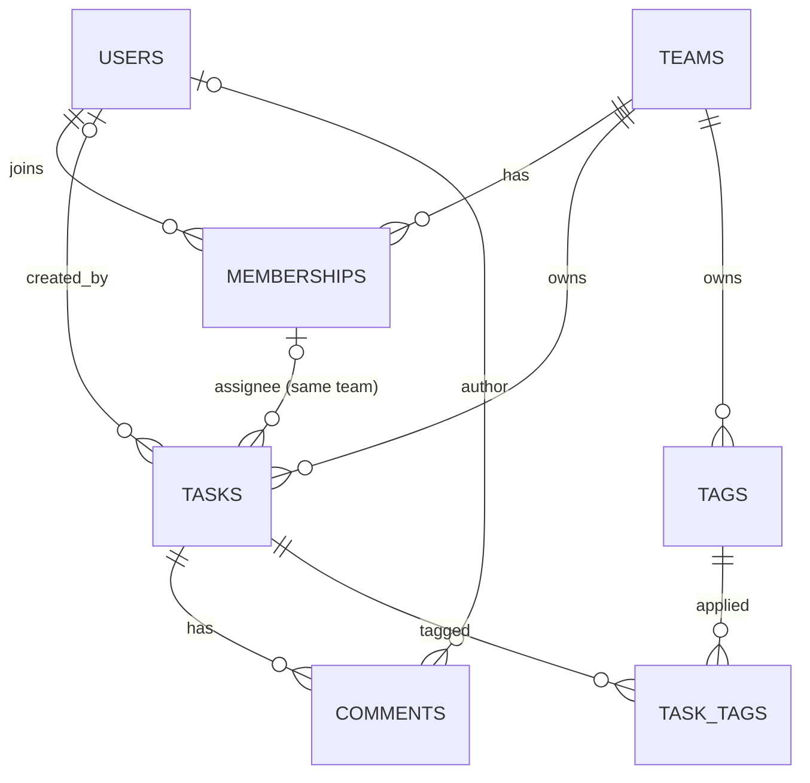

# DB-01: Multi-tenant Task Management Schema (PostgreSQL 16)

A relational schema for a task app where many teams (tenants) share one database but can never see or link to each other's data.

Built as the DB-01 task of the Minab I.T Solutions internship study plan.

## Files

| File | Purpose |
|---|---|
| `schema.sql` | Tables, constraints, foreign keys, indexes (one transaction) |
| `seed.sql` | Sample data: two tenants (Acme, Globex) and one user in both |
| `verify.sql` | Integrity tests: expected failures, cascades, index usage |

## Entity relationships



| Relationship | Type | Implemented by |
|---|---|---|
| Team to tasks, tags | One-to-many | `tasks.team_id`, `tags.team_id` |
| Task to comments | One-to-many | `comments.task_id` |
| Users and teams | Many-to-many | `memberships` (carries `role`) |
| Tasks and tags | Many-to-many | `task_tags` |

## Design decisions

**UUID v4 primary keys.** `gen_random_uuid()` (built in since PostgreSQL 13). IDs are hard to guess, unique across tables, and can be generated by application code. Trade-off: 16 bytes instead of 4, so larger indexes.

**Tenant isolation is enforced by the database, not by application code.**
- Every team-owned table carries `team_id NOT NULL`.
- `tasks (team_id, assignee_id)` references `memberships (team_id, user_id)`, so a task can only be assigned to a member of its own team.
- `task_tags` carries `team_id` and has composite foreign keys to both `tasks (id, team_id)` and `tags (id, team_id)`, so a tag from another team cannot be attached.
- Tag names are unique per team, case-insensitively.

**Delete behaviour is chosen per relationship**, by asking "does the child still make sense without the parent?"

| Foreign key | Rule | Reason |
|---|---|---|
| `memberships` to team or user | `CASCADE` | A membership is meaningless without either side |
| `tasks.team_id` | `CASCADE` | A task without a team has no meaning |
| `tasks.created_by` | `SET NULL` | Keep the task if its creator leaves |
| `tasks (team_id, assignee_id)` | `SET NULL (assignee_id)` | Unassign the task, keep `team_id` (PostgreSQL 15+) |
| `comments.task_id` | `CASCADE` | Comments belong to their task |
| `comments.author_id` | `SET NULL` | Keep the discussion if the author leaves |
| `tags`, `task_tags` | `CASCADE` | Dependents of team, task or tag |

**Data integrity with constraints.** `NOT NULL`, `UNIQUE`, and `CHECK` on status (`todo`, `in_progress`, `done`), priority (1 to 5), role (`owner`, `admin`, `member`), non-blank text, lowercase emails, and slug format.

**Indexes match query filters.**

| Index | Query it serves |
|---|---|
| `tasks (team_id, status)` | A team's board filtered by status |
| `tasks (team_id, due_date)` partial | Upcoming deadlines |
| `tasks (assignee_id, status)` partial | "My open tasks" |
| `comments (task_id, created_at)` | A task's comment thread in order |
| `memberships (user_id)` | Which teams is this user in? |
| `task_tags (tag_id)` | All tasks with a tag |
| GIN on `to_tsvector('english', title \|\| description)` | Full-text task search |

**Timestamps.** `created_at` and `updated_at` are `TIMESTAMPTZ`. A trigger to keep `updated_at` current is the next task (DB-02), so it is not in this schema yet.

## Run it

Using a local PostgreSQL:

```bash
createdb taskapp
psql -d taskapp -v ON_ERROR_STOP=1 -f schema.sql
psql -d taskapp -v ON_ERROR_STOP=1 -f seed.sql
psql -d taskapp -f verify.sql
```

Using the Docker Compose stack from `../dockertut` (`-T` lets `psql` read the file from standard input):

```bash
cd ../dockertut
docker compose exec db psql -U admin -d appdb -c "CREATE DATABASE taskapp;"
docker compose exec -T db psql -U admin -d taskapp -v ON_ERROR_STOP=1 < ../db01-schema/schema.sql
docker compose exec -T db psql -U admin -d taskapp -v ON_ERROR_STOP=1 < ../db01-schema/seed.sql
docker compose exec -T db psql -U admin -d taskapp < ../db01-schema/verify.sql
```

## What `verify.sql` proves

| Test | Expected result |
|---|---|
| Assign a task to a user from another team | Rejected (`tasks_assignee_member_fk`) |
| Attach another team's tag to a task | Rejected (`task_tags_tag_fk`) |
| Create tag `BUG` when `bug` exists | Rejected (`tags_team_name_uniq`) |
| Priority 9 | Rejected (`tasks_priority_check`) |
| Add the same user to a team twice | Rejected (`memberships_pkey`) |
| Delete a user | Their tasks and comments remain, with the link cleared |
| Delete a team | Its tasks, comments, tags, memberships are removed; users remain |
| Query by team and status, and full-text search, on 50,000 rows | Uses the index instead of scanning the table |
